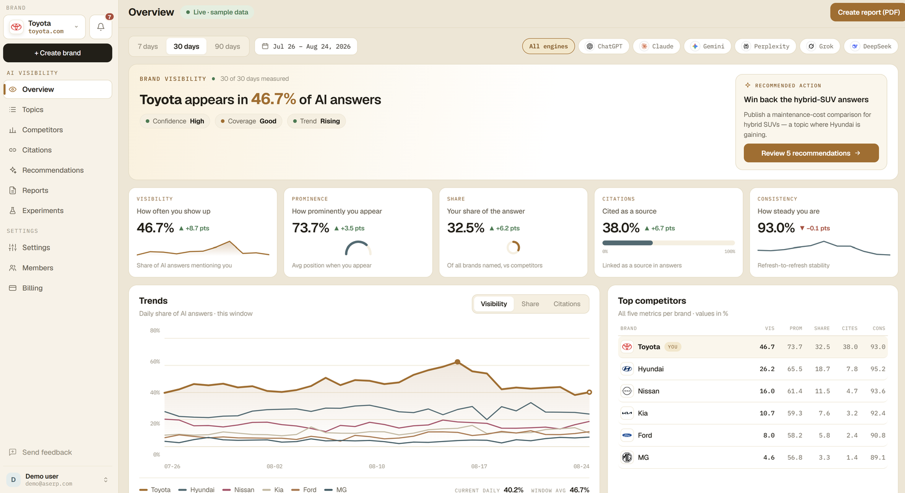

# aSERP

### AI visibility and competitive intelligence for brands

**When AI answers, does it name your brand?** 
aSERP measures how ChatGPT, Gemini, Claude, Perplexity, Grok and DeepSeek describe, cite and recommend you.

[Website](https://aserp.com) · [Free AI visibility audit](https://aserp.com) · [AEO guide](https://aserp.com/learn/aeo-guide) · [Glossary](https://aserp.com/learn/glossary) · [Contact](mailto:contact@aserp.com)

## What aSERP does

aSERP is an AI visibility platform for **answer engine optimization (AEO)** and **generative engine optimization (GEO)**. It asks AI assistants the questions your buyers ask, every day, and records the answers. From those answers it shows how often your brand is mentioned, how prominently, how much of the answer you get compared with competitors, and which websites the engines cite.

Every number comes with a confidence level, and every figure links back to the AI answer behind it.

aSERP is built for marketing, SEO and brand teams, and for agencies and enterprises that manage several brands.

  

The aSERP Overview, shown with a demo workspace and sample data.

## What you can do

| Area | What it shows |
|---|---|
| **Overview** | One AI visibility score with daily trends, plus prominence, share of answer and citations compared with your competitors. |
| **Topics** | The questions your buyers ask AI, with every answer stored word for word: which engines mention you, where you rank in each answer, and which sources were cited. |
| **Competitors** | Every rival ranked by share of AI answers, presence and citation share, with 30-day momentum, confidence levels and alerts when a new competitor appears. |
| **Citations** | The domains and pages AI engines cite in your market, where you rank among them, and winnable answers where a competitor is cited instead of you. |
| **Recommendations** | A to-do list ranked by impact. Each action is backed by evidence and explained by AI, with owners, due dates and approvals. |
| **Experiments** | Before-and-after measurement of each change on the same questions and engines, with the measured lift and a confidence level. |
| **Reports** | White-label reports as PDF, share link or XLSX, delivered on a schedule, in English or Arabic. |

## How it works

1. **Track:** add your brand, your competitors and the questions buyers ask AI.
2. **Understand:** read the answers, see who gets named and which sources the engines trust.
3. **Act:** work through recommendations ranked by impact.
4. **Prove:** run an experiment and measure whether your visibility moved.

## Measurement you can check

AI answers change from day to day and from engine to engine, so a single check can mislead. aSERP shows how confident it is in every figure, and it says *not enough data yet* instead of guessing.

Brands and competitors are matched across spellings, languages and scripts, so a mention written differently still counts. The platform also works fully in right-to-left languages such as Arabic.

Results describe the questions, engines and time period being tracked, not every AI answer on the internet.

## Learn AEO and GEO

- [AEO guide](https://aserp.com/learn/aeo-guide): answer engine optimization explained
- [AEO glossary](https://aserp.com/learn/glossary): visibility, prominence, share of answer, citations, confidence and more, defined
- [How-to guides](https://aserp.com/learn/how-to-guides): run your first AI visibility check, read your numbers, and write the questions buyers ask AI
- [Blog](https://aserp.com/blog)

## Get started

**[Get your free AI visibility audit](https://aserp.com).** No account or credit card needed. You can also start a 7-day trial at [aserp.com](https://aserp.com).

Questions: [contact@aserp.com](mailto:contact@aserp.com)
